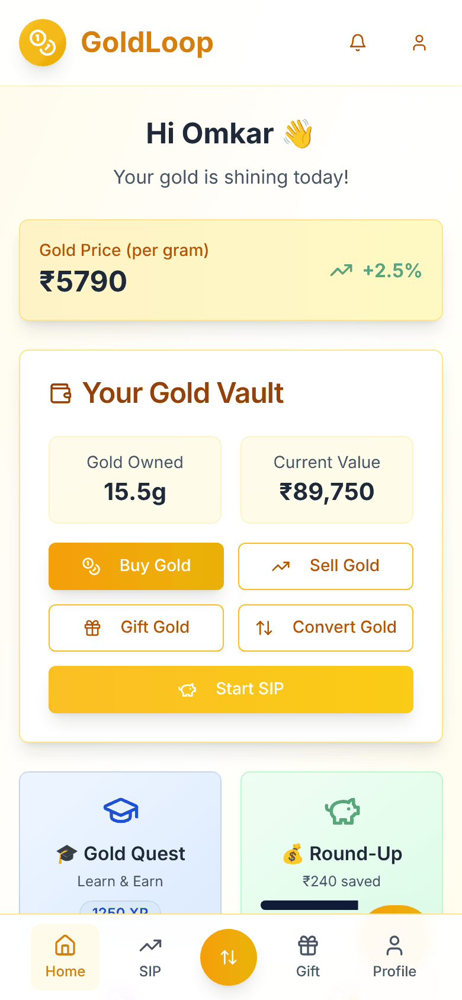
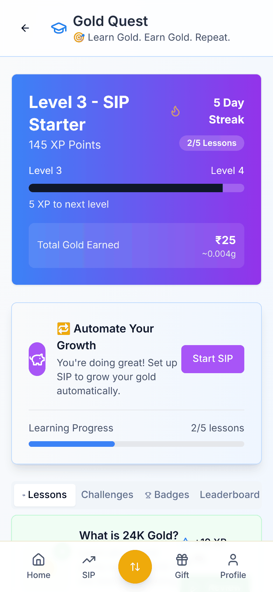
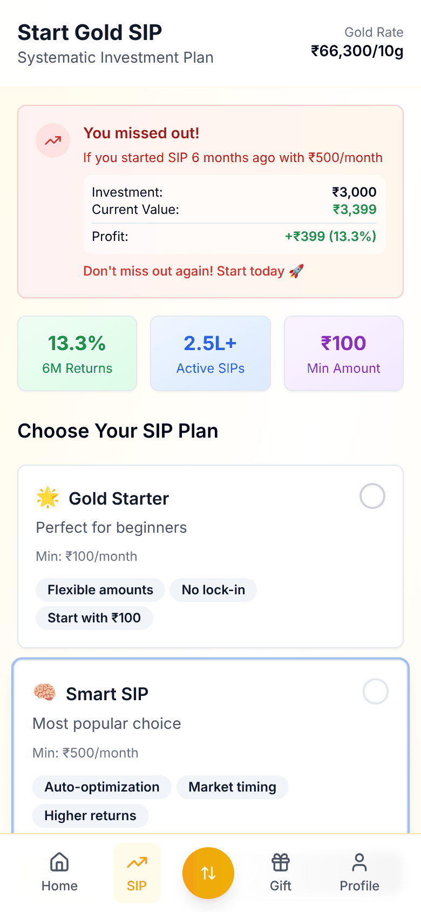
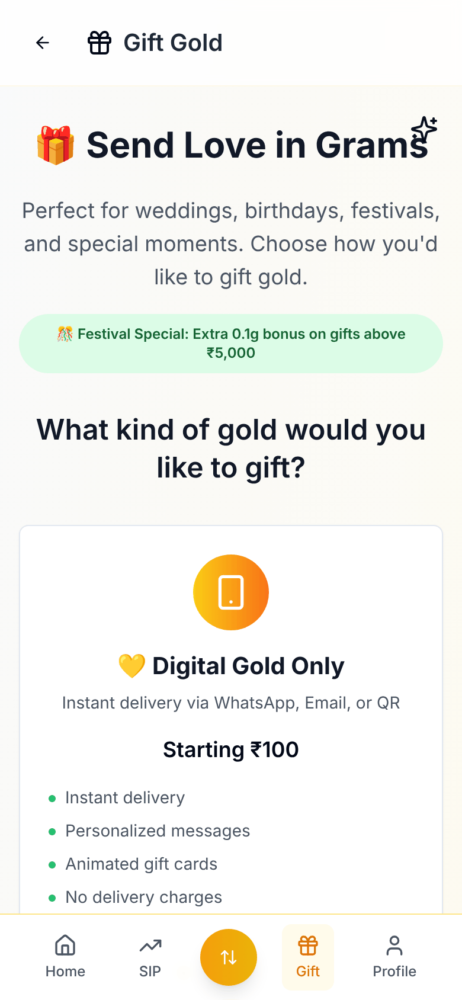
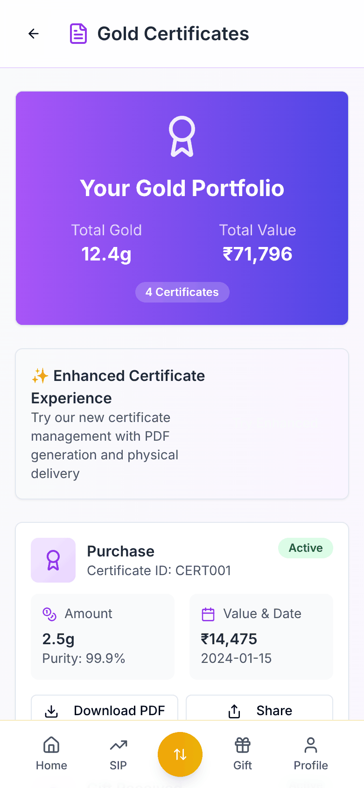
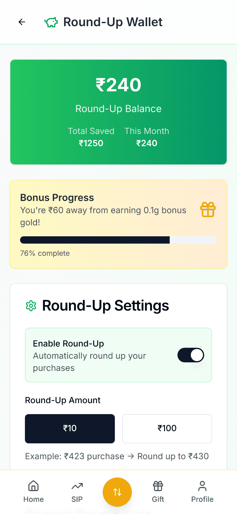

<div align="center">

# 🪙 GoldLoop

**Digital gold for India's first-time savers: start with spare change, learn as you go, and gift it in seconds.**


&nbsp;
&nbsp;
&nbsp;


</div>

---

## Why gold, and why now

Indian households own **more gold than almost anyone in the world**, but most of it sits as jewellery. It's illiquid, hard to value, and expensive to buy in small amounts. Digital gold fixes the access problem, yet existing apps treat it as a cold trading screen. For a first-time saver, the barriers are **trust** ("is this real gold?"), **knowledge** ("why gold? how much?") and **habit** (remembering to invest).

**GoldLoop is a product prototype that designs for all three.**

| Barrier | How GoldLoop answers it |
|---|---|
| **Trust** | BIS-hallmark education, downloadable certificates with a QR code, and a physical-to-digital swap at partner stores |
| **Knowledge** | *Gold Quest*: bite-sized lessons with XP, streaks, badges and a leaderboard |
| **Habit** | Gold SIPs from ₹100 a month, plus **round-ups** that turn spare change into gold automatically |
| **Emotion** | Gold gifting for weddings, festivals and birthdays: digital, physical or both ("phygital") |

## Features

### 💰 Invest
- **Buy and sell** at a live-updating price per gram, paid by UPI or card
- **Gold SIP** with plans such as *Gold Starter* (₹100 a month, no lock-in) and *Smart SIP* (auto-optimised timing). A "you missed out" nudge shows what a SIP started six months ago would be worth today.
- **Round-Up Wallet**: every purchase is rounded up to the nearest ₹10 or ₹100 and the difference goes into gold, with a progress bar towards a bonus

### 🎓 Learn (Gold Quest)
- Lessons such as *What is 24K Gold?*, *BIS Certification*, *Rupee-Cost Averaging* and *Physical vs Digital Gold*
- XP, levels, daily streaks, challenges, badges and a leaderboard. Finishing lessons earns small gold rewards.

### 🎁 Gift
- Digital gold gifts sent by WhatsApp, email or QR from ₹100, with personalised messages and animated gift cards
- Physical coins delivered to the door, or a **phygital** combination of both
- Festival offers, for example bonus gold on gifts over ₹5,000

### 🔄 Convert
- **Phygital Swap**: turn old jewellery into digital gold at a partner store, or with doorstep pickup and live tracking
- Cash out digital gold or convert it to physical coins

### 📜 Own
- A **gold certificate** for every purchase, with purity, value and date, plus PDF download, QR verification and sharing

## Product decisions

- **Gamified learning before buying.** First-time investors drop off when they don't understand what they're buying, so Quest rewards learning with small amounts of gold. Education becomes the top of the funnel.
- **Round-ups as the habit engine.** Saving money you never notice beats a monthly commitment for building the habit. SIP comes as the upsell once the user trusts the app.
- **Gifting as the growth loop.** Each gift brings in a new user who already holds gold in the app. That's the "loop" in GoldLoop.
- **Mobile-first and thumb-friendly.** Bottom navigation with a central buy/sell action, because most users will be on mid-range Android phones.

## Tech stack

| | |
|---|---|
| Framework | Next.js 15 (App Router), React 19, TypeScript |
| UI | Tailwind CSS, shadcn/ui (Radix), Lucide icons, canvas-confetti |
| Features | jsPDF (certificates), qrcode.react, Recharts, React Hook Form + Zod |

> **Prototype note:** prices, balances and user data are mocked so the flows can be tested end to end without a payments or vaulting partner.

## Run locally

```bash
git clone https://github.com/omkarpatilswork/Gold-Loop.git
cd Gold-Loop
pnpm install
pnpm dev     # http://localhost:3000
```

## More screens

&nbsp;


---

Built by **[Omkar Patil](https://github.com/omkarpatilswork)**, Product Manager · Prototyped with v0 and deployed on Vercel.
