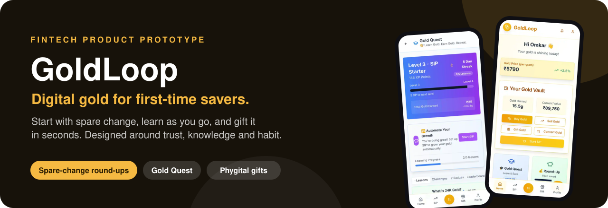
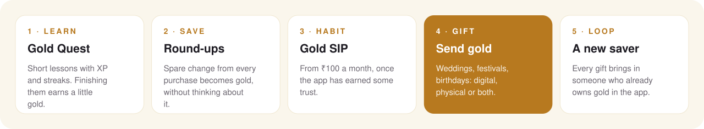

<div align="center">



<br/>

[](https://www.omkarpatil.in/#goldloop)


**[The problem](#01--the-problem)** ·
**[The product](#02--the-product)** ·
**[The loop](#03--the-loop)** ·
**[What's inside](#04--whats-inside)** ·
**[Decisions](#05--product-decisions)** ·
**[Where it stands](#06--where-it-stands)** ·
**[Run it](#07--run-it-yourself)**

</div>

---

> **A product prototype.** Prices, balances and user data are mocked so every flow can be clicked end to end without a payments or vaulting partner. No real gold is bought or sold.

---

## 01 · The problem

Indian households own **more gold than almost anyone in the world**, but most of it sits as jewellery: illiquid, hard to value and expensive to buy in small amounts. Digital gold fixes access, yet most apps treat it as a cold trading screen. For a first-time saver, three things get in the way:

- **Trust:** "Is this real gold?"
- **Knowledge:** "Why gold? How much?"
- **Habit:** remembering to invest at all.

## 02 · The product

**GoldLoop designs for all three, and adds the one thing gold already means in India: a gift.**

| Barrier | How GoldLoop answers it |
|---|---|
| **Trust** | BIS hallmark education, a downloadable certificate with a QR code for every purchase, and a physical-to-digital swap at partner stores |
| **Knowledge** | **Gold Quest**: short lessons with XP, streaks, badges and a leaderboard |
| **Habit** | Gold SIPs from ₹100 a month, and **round-ups** that turn spare change into gold automatically |
| **Emotion** | Gold gifts for weddings, festivals and birthdays: digital, physical or both ("phygital") |

<table>
<tr>
<td width="33%"><br/><sub><b>Home.</b> Live price per gram, your vault and quick actions.</sub></td>
<td width="33%"><br/><sub><b>Gold Quest.</b> Levels, streaks and lessons that pay out in gold.</sub></td>
<td width="33%"><br/><sub><b>Gold SIP.</b> Plans from ₹100 a month, and what you'd have if you'd started earlier.</sub></td>
</tr>
<tr>
<td width="33%"><br/><sub><b>Gift.</b> Digital, physical or phygital, with a personal message.</sub></td>
<td width="33%"><br/><sub><b>Round-ups.</b> Spare change into gold, with progress towards a bonus.</sub></td>
<td width="33%"><br/><sub><b>Certificates.</b> Purity, value and date, with PDF and QR.</sub></td>
</tr>
</table>

## 03 · The loop

<div align="center">

</div>

Learning comes before buying, round-ups build the habit, the SIP is the upsell, and every gift brings in a new user who already holds gold in the app. That's the "loop" in GoldLoop.

## 04 · What's inside

<details open>
<summary><b>Invest</b></summary>
<br/>

- **Buy and sell** at a live-updating price per gram, paid by UPI or card
- **Gold SIP** plans such as *Gold Starter* (₹100 a month, no lock-in) and *Smart SIP* (auto-optimised timing). A "you missed out" nudge shows what a SIP started six months ago would be worth today.
- **Round-up wallet:** each purchase is rounded up to the nearest ₹10 or ₹100 and the difference goes into gold
</details>

<details>
<summary><b>Learn: Gold Quest</b></summary>
<br/>

- Lessons such as *What is 24K Gold?*, *Gold Purity Scale*, *BIS Certification* and *Why Invest in Gold?* (all in [`lib/quest-data.ts`](lib/quest-data.ts))
- XP, levels, daily streaks, challenges, badges and a leaderboard. Finishing lessons earns small gold rewards.
</details>

<details>
<summary><b>Gift</b></summary>
<br/>

- Digital gold gifts by WhatsApp, email or QR from ₹100, with personal messages and animated cards
- Physical coins delivered to the door, or a phygital combination of both
- Festival offers, such as bonus gold on gifts over ₹5,000
</details>

<details>
<summary><b>Convert and own</b></summary>
<br/>

- **Phygital swap:** turn old jewellery into digital gold at a partner store, or with doorstep pickup and live tracking
- Cash out, or convert digital gold into physical coins
- A **gold certificate** for every purchase, with purity, value and date, plus PDF download, QR verification and sharing
</details>

## 05 · Product decisions

| Decision | Why |
|---|---|
| **Learn before you buy** | First-time investors drop off when they don't understand what they're buying. Quest rewards learning with small amounts of gold, so education becomes the top of the funnel. |
| **Round-ups as the habit engine** | Saving money you never notice beats a monthly commitment for building the habit. The SIP comes later, once the user trusts the app. |
| **Gifting as the growth loop** | Each gift brings in a new user who already holds gold in the app. |
| **Mobile-first and thumb-friendly** | Bottom navigation with a central buy and sell action, because most users will be on mid-range Android phones. |

## 06 · Where it stands

|  |  |
|---|---|
| **Status** | Clickable prototype. Written up as a case study at [omkarpatil.in/#goldloop](https://www.omkarpatil.in/#goldloop). |
| **Data** | Prices, balances and users are mocked. No payments, vaulting or KYC partner is connected. |
| **Stack** | Next.js 15 (App Router), React 19, TypeScript, Tailwind CSS, shadcn/ui, jsPDF (certificates), qrcode.react, Recharts, canvas-confetti |
| **Built with** | Prototyped with v0, deployed on Vercel |
| **Tests** | None. |

**What it is not:** a regulated product. Real digital gold needs a vaulting partner, KYC and payment rails, and none of that is built.

## 07 · Run it yourself

```bash
git clone https://github.com/omkarpatilswork/Gold-Loop.git
cd Gold-Loop
pnpm install
pnpm dev             # http://localhost:3000
```

## Repository map

```
Gold-Loop/
├── app/
│   ├── buy/  sell/  sip/   invest
│   ├── quest/              Gold Quest lessons and rewards
│   ├── roundup/            round-up wallet
│   ├── gift/               digital, physical and phygital gifts
│   ├── swap/  convert/     jewellery to digital, digital to coins
│   ├── certificate/        purchase certificates
│   └── profile/
├── components/             certificate, delivery flow, rewards, bottom nav
├── lib/                    quest content, PDF generator
└── docs/                   screenshots and README diagram
```

---

<div align="center">
<sub>Built by <a href="https://www.omkarpatil.in">Omkar Patil</a>, product manager · prototyped with v0</sub>
</div>
